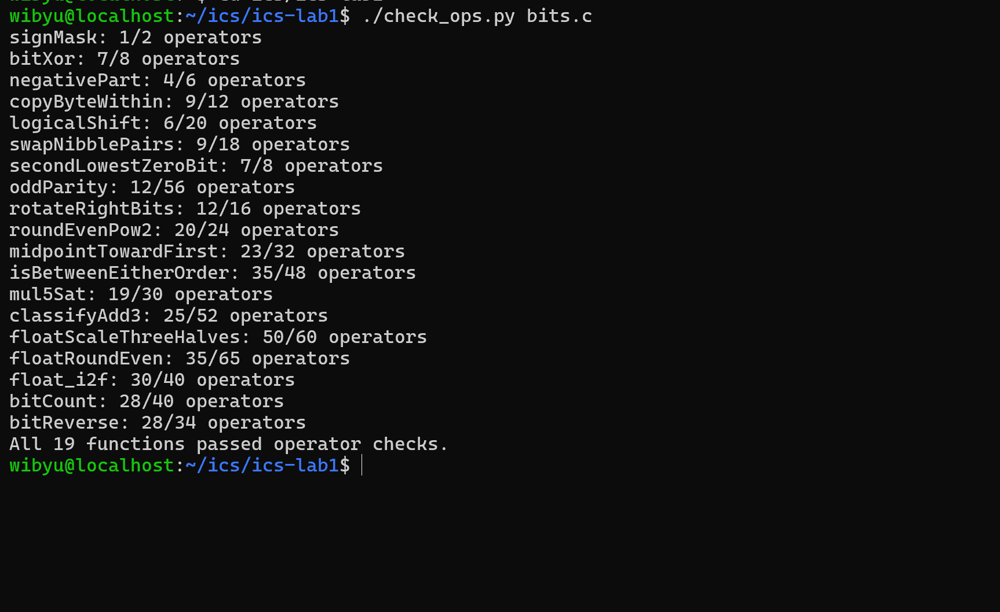
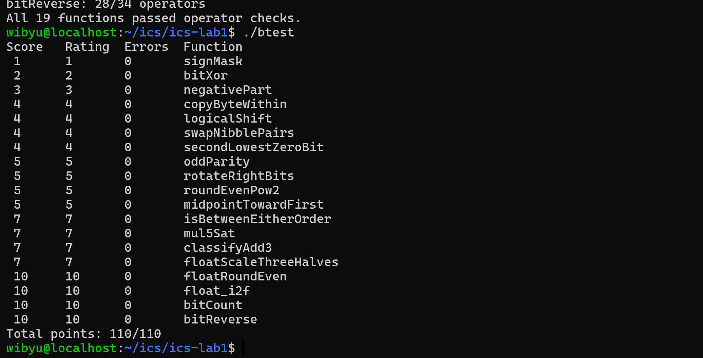

# Lab 1：Data Lab 实验报告

## 一、测试结果

终端执行 `./check_ops.py bits.c`，19 个函数全部通过运算符与操作数规则检查：

**【截图 1：./check_ops.py bits.c 运行结果】**

终端执行 `./btest`，全部题目 `Errors` 为 0，总分 `Total points: 110/110`：

**【截图 2：./btest 运行结果】**

## 二、各函数实现思路

### P1 signMask（1 op）

将常量 `1` 左移 31 位，即得只有最高位为 1 的掩码：`return 1 << 31;`。

### P2 bitXor（7 ops）

只允许 `~` 和 `&`。按位分析：`x ^ y` 为 1 当且仅当"不同时为 1"且"不同时为 0"，故
`x ^ y = ~(x & y) & ~(~x & ~y)`。

### P3 negativePart（4 ops）

用算术右移生成掩码：`x >> 31` 在 `x < 0` 时为全 1，否则为全 0；`~x + 1` 即 `-x`。两者相与完成条件选择。`x = INT_MIN` 时 `-x` 回绕为自身，恰为期望输出。

### P4 copyByteWithin（9 ops）

把字节编号换算成移位量 `ss = src*8`、`ds = dst*8`；`(x >> ss) & 0xff` 取出源字节，`x & ~(0xff << ds)` 清掉目标字节，最后将源字节左移到位后或入。

### P5 logicalShift（6 ops）

直接算术右移后，用掩码清掉高位被符号扩展进来的 1。`((1<<31) >> n) << 1` 恰好生成"高 n 位为 1"的模式，取反后即低 `32-n` 位的掩码；`n = 0` 时左移把唯一的一位挤掉，掩码为全 1，原样返回。

### P6 swapNibblePairs（9 ops）

用 8 位常数拼出掩码 `m = 0x0F0F0F0F`（`(0x0f | 0x0f<<8)` 再 `| (m<<16)`）。低半字节左移 4 位，与高半字节右移 4 位（同样经 `m` 过滤）的结果相或。

### P7 secondLowestZeroBit（7 ops）

取 `t = ~x`，则 `t` 中为 1 的位对应 `x` 中为 0 的位。`u = t & (t - 1)`（`t - 1` 写作 `t + ~0`）清除最低位的 0，再用 `u & (-u)` 取出当前最低位的 1，即次低位的 0 的位置。

### P8 oddParity（12 ops）

对半折叠求奇偶性：依次 `x ^= x >> 16`、`>> 8`、`>> 4`、`>> 2`、`>> 1`，最终 `x & 1` 即 32 位的奇偶位（1 的个数为奇数时为 1）。题目要求偶数个 1 时返回 1，故再 `^ 1` 取反。

### P9 rotateRightBits（12 ops）

先 `s = n & 31` 把移位量归约到 0 至 31。右半部分是 P5 式逻辑右移的结果；左半部分为 `x << (32 - s)`，写作 `x << ((33 + ~s) & 31)`——外层再 `& 31` 归约，避免 `s = 0` 时移位 32 位的未定义行为。两部分相或。

### P10 roundEvenPow2（20 ops）

令 `block = 2^n`、商 `q = x >> n`、余数 `low = x & (block - 1)`、半块 `half = block >> 1`。比较 `t = low - half`：`t > 0` 向上进位；`t = 0` 恰好一半，按 round-to-even 仅在商为奇数时进位；`t < 0` 不进位。结果 `(q + inc) << n`。题目保证 `x <= 0x3fffffff`，进位不会溢出。

### P11 midpointTowardFirst（23 ops）

由恒等式 `x + y = 2*(x & y) + (x ^ y)`，`base = (x & y) + ((x ^ y) >> 1)` 即 `floor((x+y)/2)`，且全程不产生溢出。当 `x + y` 为奇数时中点恰在两整数之间，此时若 `x > y` 则向 `x` 靠拢（加 1），修正量 `corr = odd & gt`。判断 `x > y` 分两类避免减法溢出：符号不同时看谁非负；符号相同时 `x - y` 不会溢出，直接看差的符号。

### P12 isBetweenEitherOrder（35 ops）

`x` 不在闭区间内，当且仅当 `x` 严格小于两个端点，或严格大于两个端点。为容忍减法溢出，采用符号修正的比较法：对 `d = x - y`、`t = x ^ y`，表达式 `(d ^ (t & (d ^ x))) >> 31` 在溢出时把符号位翻回真实大小关系，得到"`x < y`"的全 1/全 0 掩码。算出 `below = (x<a) & (x<b)` 与 `above = (x>a) & (x>b)`，返回 `~(below | above) & 1`。

### P13 mul5Sat（19 ops）

先算 `t = (x << 2) + x`（`5x` 的低 32 位）。溢出检测有两条路径：`mag` 检查 `x` 的高 3 位是否不全是符号位（即 `|x|` 大到必然溢出）；另一条是乘积符号翻转检测 `s ^ (t >> 31)`，两条取或。饱和值 `sat = 0x7FFFFFFF ^ s`（正溢出得 `INT_MAX`，负溢出得 `INT_MIN`），最后用掩码 `(ovf & sat) | (~ovf & t)` 完成选择。

### P14 classifyAdd3（25 ops）

分两段做加法，分别记录溢出方向。第一次 `s1 = x + y`：同号相加且结果符号相反即溢出，正溢出记 `+1`、负溢出记 `-1`（位运算拼出带符号计数）。第二次 `s2 = s1 + z` 同理。真实和在范围内时，两次溢出要么没有、要么方向相反而抵消，净计数为 0；超出上界时净剩 `+1`，低于下界时净剩 `-1`，直接返回两段计数之和。

### P15 floatScaleThreeHalves（50 ops）

拆出符号、阶码、尾数后分四类：

- NaN/Inf（`exp == 0xFF`）与正负 0 直接返回原值（保持符号）；
- 次正规输入：值为 `frac x 2^-149`，令 `t = 3xfrac`，右移一位并按 round-to-even 进位；若结果达到 `2^23` 则升格为正规数，阶码取 1；
- 正规输入：有效数字 `sig = frac | 2^23`，`t = 3xsig` 最多 26 位；`t` 有第 25 位则右移两位、阶码加 1，否则右移一位，丢弃位按 round-to-nearest-even 进位；
- 进位可能使有效数字进位到 `2^24`，需再右移并升阶；阶码达到 255 时返回同号无穷大。

### P16 floatRoundEven（35 ops）

- `exp == 0xFF` 返回原值；`exp >= 150` 时有效数字内已无小数位，直接返回；
- `exp < 126`（`|f| < 0.5`）舍入为 0，只返回符号位以保留 `-0`；
- `exp == 126`（`0.5 <= |f| < 1`）：恰为 0.5 时按 round-to-even 归 0，否则舍入为正负 1（`0x3F800000`）；
- 其余情况：`shift = 150 - exp` 是需丢弃的小数位数，取出保留部分 `base`、丢弃部分 `rest` 与半单位 `half`，按 round-to-even 决定是否进位；若进位后 `base` 恰为 2 的幂，构造阶码加 1 的结果，否则把 `base` 左移回去后截取低 23 位作尾数。

### P17 float_i2f（30 ops）

先记符号并取绝对值 `a`（`INT_MIN` 取负回绕后作为无符号数仍是正确绝对值）。循环右移求最高有效位的位置 `e`，阶码即 `e + 127`。若 `e > 23` 需丢弃 `e - 23` 位：取保留位 `keep`、丢弃位 `dropped` 与中点 `half`，按 round-to-even 进位；进位若达 `2^24` 则恢复为 `2^23`、阶码加 1。`e <= 23` 时直接左移对齐。最后拼接符号、阶码、尾数。

### P18 bitCount（28 ops）

经典 SWAR 并行计数。用小常数拼出 `0x55555555`、`0x33333333`、`0x0F0F0F0F` 三个掩码：依次把每 2 位、每 4 位、每 8 位压缩成其中 1 的个数；此后每字节计数不超过 8，直接 `x + (x >> 8)`、`x + (x >> 16)` 累加，最后与 `0x3f` 取总数。

### P19 bitReverse（28 ops）

分治交换，粒度从 1 位逐级扩大到 16 位。掩码均由 8 位常数拼装：`m4 = 0x0F0F0F0F`，`m2 = m4 ^ (m4 << 2)`（得 `0x33333333`），`m1 = m2 ^ (m2 << 1)`（得 `0x55555555`），另有 `m8 = 0x00FF00FF`、`m16 = 0x0000FFFF`。依次执行 1、2、4、8、16 位的成组交换，完成 32 位逆序。

## 三、调试与测试过程

1. 每次修改后执行 `make clean && make all` 重新编译；
2. `./check_ops.py bits.c` 检查运算符合法性与操作数上限；
3. `./btest` 全量测试，对失败的题目用 `./btest -f 函数名` 配合 `-1/-2/-3` 指定参数单独回归；
4. 借助 `./ishow`、`./fshow` 观察整数与浮点数的位级表示，定位符号、溢出、舍入和特殊值相关的问题。

## 四、参考资料

- 《深入理解计算机系统（CS:APP，第 3 版）》第 2 章：信息的表示和处理
- 课程实验文档：<https://ics-26fall-fdu.github.io/labs/lab1-data-lab/>
- 仓库内 `README.md` 与 `bits.c` 中的逐题说明

## 五、实验感受（可选）

通过本实验对补码的边界行为（溢出回绕、算术右移、`INT_MIN` 的特殊性）和 IEEE 754 的规格化/非规格化、round-to-even 舍入有了更具体的认识。印象最深的两点：一是"掩码 + 移位"可以在没有分支的条件下实现条件选择；二是 round-to-nearest-even 在三道浮点题里反复出现，但每题的进位传播细节都不一样。
